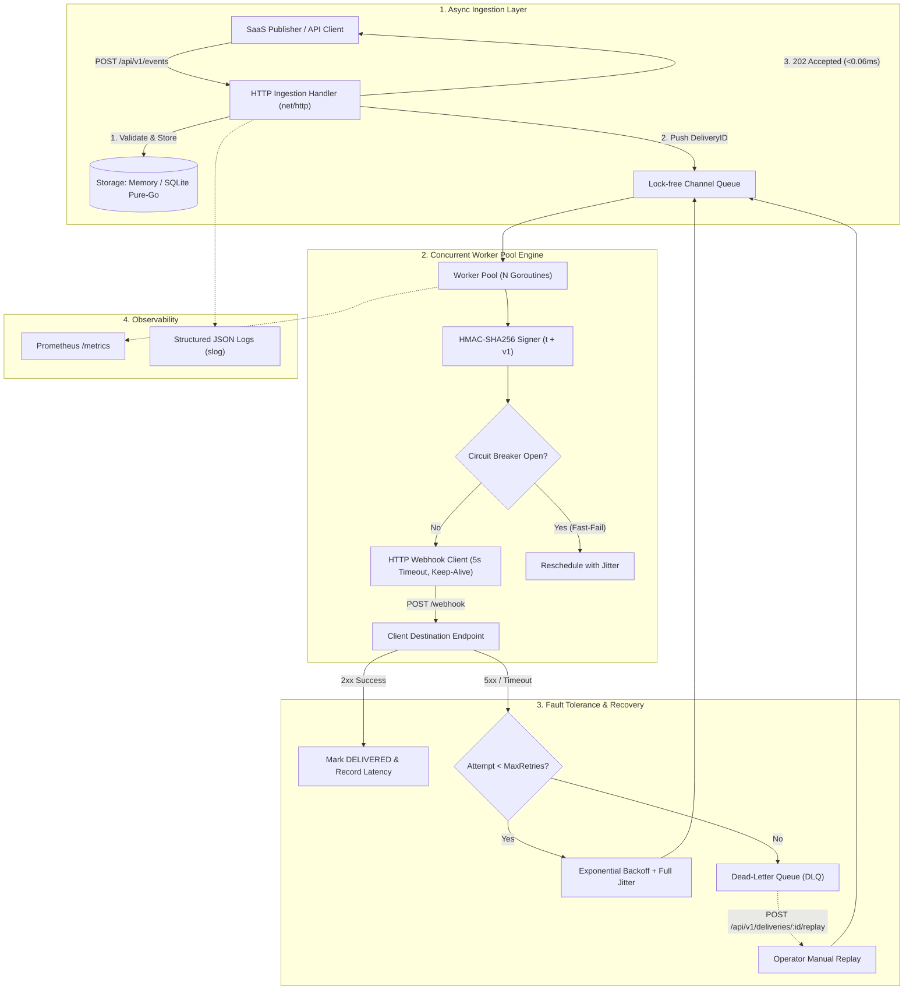

# RelayHook ⚡

> **Motor Concurrente de Entrega de Webhooks para SaaS de Alto Rendimiento**  
> *Production-Grade Concurrent Webhook Delivery Engine for Modern SaaS*  
> Portafolio & Caso de Estudio: [daikodev.com](https://daikodev.com)

[](https://go.dev)
[](LICENSE)
[](#arquitectura--architecture)
[](#rendimiento-y-benchmarks--performance)

---

## 🇪🇸 Descripción General

**RelayHook** es un microservicio de infraestructura diseñado para resolver el desafío crítico de despachar millones de eventos mediante webhooks a endpoints de clientes de forma segura, confiable y asíncrona.

Inspirado en los sistemas de eventos de **Stripe** y **Svix**, RelayHook desacopla la recepción HTTP de la entrega física a través de un **Worker Pool Concurrente**, implementando **firmas criptográficas HMAC-SHA256 con protección anti-repetición**, **reintentos con backoff exponencial y full jitter**, **circuit breakers por endpoint**, **cola de mensajes no entregados (Dead-Letter Queue - DLQ)** y observabilidad nativa para **Prometheus**.

---

## 🇬🇧 Overview

**RelayHook** is an infrastructure microservice built to solve the high-stakes problem of delivering mission-critical webhooks to external client endpoints reliably, concurrently, and securely.

Inspired by industry-standard architectures like **Stripe** and **Svix**, RelayHook separates HTTP event ingestion from dispatching using a **Concurrent Worker Pool**, featuring **HMAC-SHA256 cryptographic signing with anti-replay protection**, **exponential backoff with full jitter**, **per-endpoint circuit breaking**, **Dead-Letter Queue (DLQ)** with manual replay, and native **Prometheus** metrics.

---

## Arquitectura / Architecture



---

## Características Principales / Key Features

* **Ingesta Asíncrona Ultrarrápida:** Responde `202 Accepted` en menos de **0.06ms** ($50\,\mu\text{s}$) garantizando que tus APIs emisoras nunca se bloqueen.
* **Worker Pool Concurrente:** Procesamiento paralelo en goroutines fijas con sincronización limpia (`sync.WaitGroup`) y drenado ordenado (*Graceful Shutdown*).
* **Firma Criptográfica HMAC-SHA256:** Cabeceras `X-RelayHook-Signature: t=<timestamp>,v1=<hex>` y `X-RelayHook-Timestamp` para autenticación y protección contra ataques de repetición (*replay attacks*).
* **Backoff Exponencial con Full Jitter:** Fórmula $\text{random}(0, \min(M, B \times 2^{\text{attempt}}))$ protegida contra desbordamiento entero para evitar tempestades de reintentos (*thundering herd*).
* **Circuit Breakers por Endpoint:** Aislamiento de vecinos ruidosos (*noisy neighbors*). Estados `CLOSED`, `OPEN` y `HALF-OPEN` con sondas únicas de prueba para no saturar servidores caídos.
* **Dead-Letter Queue (DLQ) & Replay:** Registro detallado de fallos persistentes y endpoints dedicados para inspeccionar y reinyectar webhooks a la cola.
* **Almacenamiento Desacoplado:** Repositorio en memoria thread-safe (`MemoryStore`) y base de datos persistente SQLite 100% puro Go (`modernc.org/sqlite` con WAL) sin requerir compilador CGO ni dependencias externas.
* **Observabilidad Completa:** Métricas Prometheus en `/metrics` (RPS, latencias con histogramas, workers activos, tamaño de cola, estados de circuit breaker) y logs estructurados JSON con `log/slog`.
* **Herramienta Complementaria `mock-receiver`:** Receptor de webhooks con verificación HMAC y simulación de caos (inyección de fallos, latencias artificiales).

---

## Rendimiento y Benchmarks / Performance

Pruebas ejecutadas con el benchmark formal de Go en hardware estándar (`go test -bench=BenchmarkIngestEvent -benchmem ./internal/handler`):

```text
BenchmarkIngestEvent-2   	   29184	     50367 ns/op	   11701 B/op	      96 allocs/op
```

* **Latencia promedio de ingesta:** **~0.05 ms** (muy por debajo del SLA objetivo de `<2ms`).
* **Throughput:** Más de **20,000 eventos/segundo** en un solo nodo.
* **Condiciones de carrera:** **0 data races** verificado con `go test -race ./...`.

---

## Inicio Rápido / Quickstart

### 1. Compilación Local / Local Build

```bash
git clone https://github.com/daiko-dev/relayhook.git
cd relayhook

# Compilar binarios
make build

# Ejecutar el servidor RelayHook en el puerto 8080
make run
```

### 2. Ejecutar con Docker Compose

```bash
docker compose up -d
```
Levantará:
- **RelayHook** en `http://localhost:8080`
- **Mock-Receiver** en `http://localhost:9090`
- **Prometheus** en `http://localhost:9091`

---

## Ejemplos de Uso con `curl` / API Walkthrough

### 1. Registrar una Aplicación / Tenant
```bash
curl -X POST http://localhost:8080/api/v1/apps \
  -H "Content-Type: application/json" \
  -d '{"name": "E-Commerce Platform"}'
```

### 2. Registrar un Endpoint de Destino
```bash
curl -X POST http://localhost:8080/api/v1/endpoints \
  -H "Content-Type: application/json" \
  -d '{
    "app_id": "default",
    "url": "http://localhost:9090/webhook",
    "secret": "whsec_supersecretkey12345",
    "event_types": ["order.created", "invoice.paid"],
    "max_retries": 5
  }'
```

### 3. Ingestar un Evento (Con Idempotencia)
```bash
curl -X POST http://localhost:8080/api/v1/events \
  -H "Content-Type: application/json" \
  -H "Idempotency-Key: idempotency-tx-998877" \
  -d '{
    "event_type": "order.created",
    "payload": {
      "order_id": "ord_99001",
      "amount": 250.50,
      "currency": "USD",
      "customer": "daiko-dev"
    }
  }'
```
*Respuesta inmediata `202 Accepted`:*
```json
{
  "event_id": "evt_4a71bf088912d8",
  "id": "evt_4a71bf088912d8",
  "status": "queued",
  "deliveries_queued": 1,
  "delivery_ids": ["dlv_89cf0012a9e1"]
}
```

### 4. Inspeccionar la Dead-Letter Queue (DLQ)
```bash
curl http://localhost:8080/api/v1/dlq
```

### 5. Reenviar un Webhook Fallido
```bash
curl -X POST http://localhost:8080/api/v1/deliveries/dlv_89cf0012a9e1/replay
```

### 6. Consultar Métricas Prometheus
```bash
curl http://localhost:8080/metrics
```

---

## Verificación de Firmas en el Cliente (Go SDK)

RelayHook incluye un paquete exportable en `pkg/sdk` para que los consumidores validen firmas con protección anti-repetición en 3 líneas de código:

```go
package main

import (
	"log"
	"net/http"
	"time"

	"github.com/daiko-dev/relayhook/pkg/sdk"
)

func webhookHandler(w http.ResponseWriter, r *http.Request) {
	secret := "whsec_supersecretkey12345"
	verifier := sdk.NewVerifier(secret, 5*time.Minute)

	payload, err := verifier.VerifyRequest(r)
	if err != nil {
		http.Error(w, "Firma de webhook inválida", http.StatusUnauthorized)
		return
	}

	log.Printf("Webhook válido recibido: %s", string(payload))
	w.WriteHeader(http.StatusOK)
}
```

---

## Pruebas Automatizadas / Testing Suite

```bash
# Ejecutar todas las pruebas unitarias y de integración
make test

# Ejecutar con detector de condiciones de carrera (0 data races garantizado)
make test-race

# Ejecutar suite de pruebas de caja opaca E2E (Tiers 1 a 4)
RELAYHOOK_REQUIRE_E2E=1 go test -v ./tests/e2e/...

# Ejecutar benchmarks de rendimiento
make bench
```

---

## Autor & Contacto / Author

Desarrollado como proyecto de ingeniería de sistemas concurrentes en Go por **Daiko**:
* **Website / Portfolio:** [daikodev.com](https://daikodev.com)
* **GitHub:** [@daiko-dev](https://github.com/daiko-dev)
* **Licencia:** MIT License
